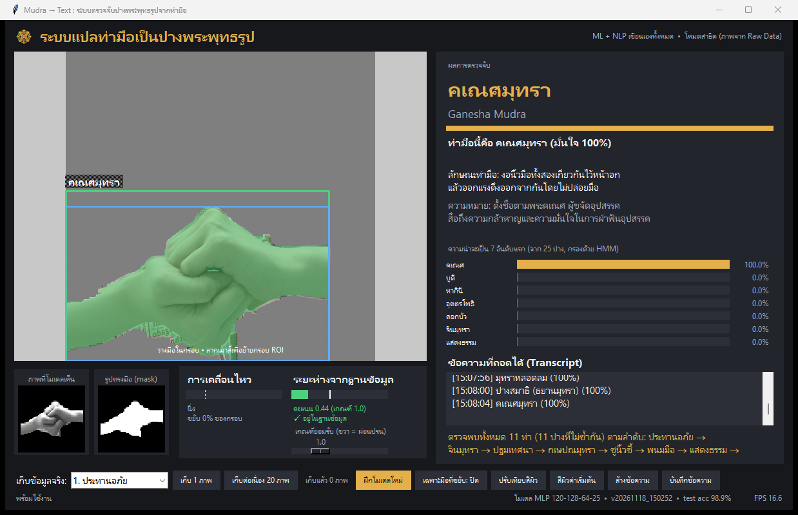
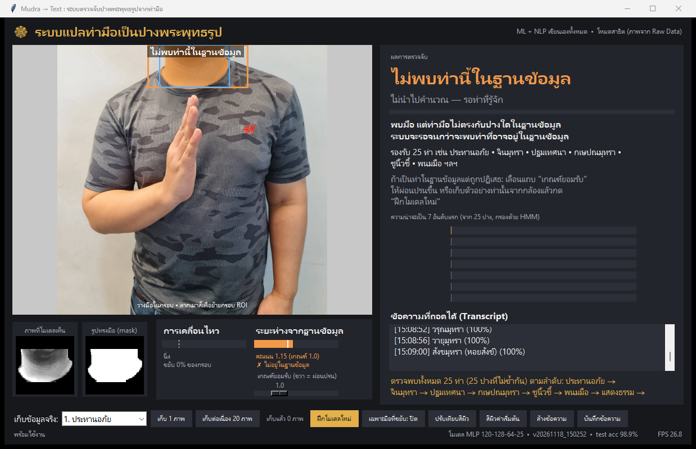
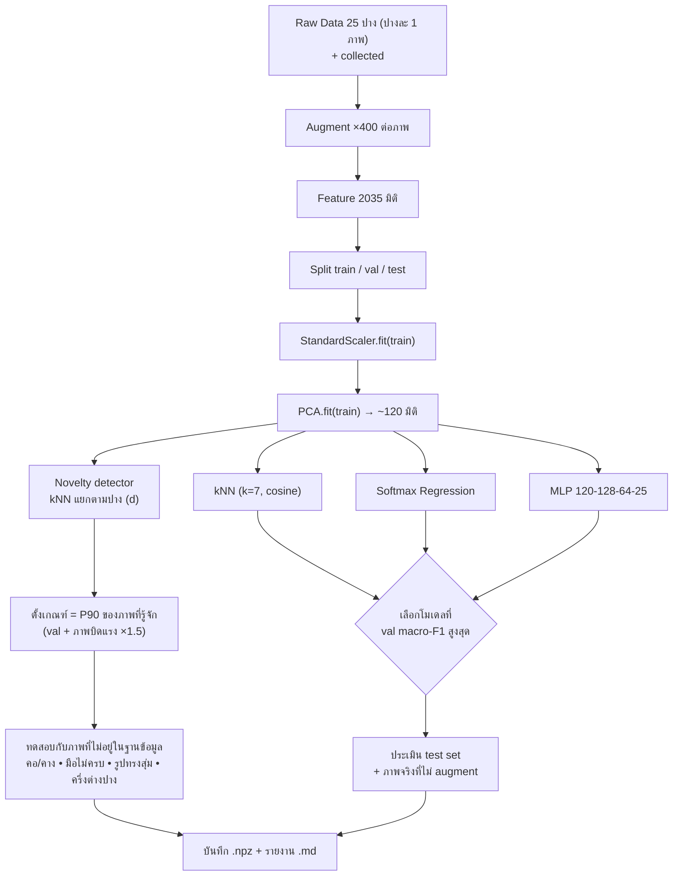
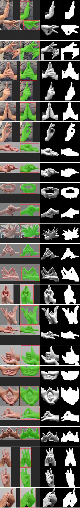

# ☸ ระบบแปลท่ามือเป็นปางพระพุทธรูปและมุทรา (มุทรา → ข้อความภาษาไทย)

โปรแกรมภาษา Python ที่ใช้หลักการ **Machine Learning** และ **NLP** ตรวจจับ "ท่ามือ (มุทรา)" ของผู้ใช้ผ่านกล้อง
แล้วแปลงเป็น **ข้อความภาษาไทย** บอกว่าเป็นปาง/มุทราอะไร มีความหมายอย่างไร — รองรับ **25 ท่า** จากโฟลเดอร์ `Raw Data`

- **หน้าจอซ้าย** — ภาพจากกล้อง จับการเคลื่อนไหว (สีแดง) และบริเวณมือ (สีเขียว) ภายในกรอบ ROI
- **หน้าจอขวา** — ชื่อปาง ความมั่นใจ ลักษณะท่ามือ ความหมาย ความน่าจะเป็น 7 อันดับแรก และข้อความที่ถอดได้ต่อเนื่อง (transcript)
- **ท่าที่ไม่อยู่ในฐานข้อมูล จะไม่ถูกนำไปคำนวณ** — ระบบตรวจก่อนว่ามือที่เห็น "อาจเป็นปางในฐานข้อมูล" หรือไม่ (Open-set recognition)
  ถ้าไม่ใช่ จะขึ้นว่า *ไม่พบท่านี้ในฐานข้อมูล* และรอจนกว่าจะพบท่าที่รู้จัก โดยไม่ส่งภาพให้โมเดลจำแนกและไม่บันทึกเป็นข้อความ
- ข้อมูลตั้งต้นมาจากโฟลเดอร์ **`Raw Data`**
- **ไม่ใช้ไลบรารี ML/NLP/Computer Vision สำเร็จรูป** ทุกอัลกอริทึมเขียนเอง ครบทั้ง **วงจรชีวิตของ ML (ML Lifecycle)**

| ท่าที่อยู่ในฐานข้อมูล → แปลเป็นข้อความ | ท่าที่ไม่อยู่ในฐานข้อมูล → ไม่นำไปคำนวณ |
|---|---|
|  |  |

---

## 1. ข้อกำหนด "ไม่ใช้ไลบรารี — ทำเองทั้งหมด"

| สิ่งที่ต้องทำ | ใช้อะไร | หมายเหตุ |
|---|---|---|
| แยกสีผิว, เบลอ, morphology, connected components, ย่อ/หมุนภาพ | **เขียนเอง** (`mudra/image_ops.py`, `segmentation.py`) | ไม่เรียกฟังก์ชันประมวลผลภาพของ OpenCV เลย |
| สกัดฟีเจอร์ HOG, Hu moments, รูปทรง | **เขียนเอง** (`mudra/features.py`) | |
| Data augmentation, แบ่ง train/val/test | **เขียนเอง** (`mudra/dataset.py`) | |
| StandardScaler, PCA (+ หาค่าลักษณะเฉพาะด้วย Jacobi) | **เขียนเอง** (`mudra/preprocessing.py`) | ไม่ใช้ `np.linalg` |
| kNN, Softmax Regression, MLP + Backprop + Adam | **เขียนเอง** (`mudra/models.py`) | ไม่ใช้ scikit-learn / TensorFlow / PyTorch |
| Open-set recognition (ปฏิเสธท่าที่ไม่อยู่ในฐานข้อมูล): kNN แยกตามปาง + เกณฑ์ความมั่นใจ | **เขียนเอง** (`mudra/novelty.py`, `pipeline.py`) | |
| Accuracy, Precision, Recall, F1, Confusion matrix | **เขียนเอง** (`mudra/metrics.py`) | |
| HMM (Forward / Viterbi), Tokenization, สร้างประโยคภาษาไทย | **เขียนเอง** (`mudra/nlp.py`) | ไม่ใช้ NLTK / PyThaiNLP |
| ตรวจจับการเคลื่อนไหว (background subtraction) | **เขียนเอง** (`app.py`) | |
| เลือก "มือ" จากสีผิว + การเคลื่อนไหว + ติดตามมือ, ตัดหน้า/คอ, ตัดแขนที่ข้อมือ | **เขียนเอง** (`mudra/segmentation.py`, `pipeline.py`) | |
| หน้าจอโปรแกรม | `tkinter` (มากับ Python) | แปลงภาพเป็น PPM เอง ไม่ใช้ PIL |
| อาร์เรย์ตัวเลข | `numpy` | ใช้แค่ บวก/ลบ/คูณเมทริกซ์ |
| **เปิดกล้อง + อ่าน/เขียนไฟล์รูป JPG/PNG** | `opencv-python` | **ใช้เฉพาะ I/O** (`VideoCapture`, `imdecode`, `imencode`) ใน `mudra/io_utils.py` ไฟล์เดียว |
| ไม่ให้ใบหน้า/คอถูกนับเป็นมือ | **เขียนเอง** — กรอบ ROI + โหมด "เฉพาะมือที่ขยับ" (`segmentation.py`, `pipeline.py`) | ใบหน้าที่นิ่งอยู่จะไม่ถูกเลือกเป็นมือ |

> ไม่ใช้ MediaPipe, scikit-learn, TensorFlow, Keras, PyTorch, PIL, scikit-image, NLTK, PyThaiNLP
> และไม่ใช้โมเดล/ตัวตรวจจับสำเร็จรูปของ OpenCV — เวอร์ชันก่อนเคยใช้ Haar cascade หาใบหน้า ซึ่งเป็นโมเดล ML สำเร็จรูป
> จึงถอดออกให้ตรงข้อกำหนด (ได้ลองเขียนตัวหาใบหน้าเองด้วยกฎสีผิว+รูปทรงแล้ว แต่จับมือเป็นหน้าในภาพใกล้ จึงไม่ใช้)

---

## 2. ปางและมุทราที่รองรับ (25 คลาส จาก `Raw Data` — ใช้ครบทุกภาพ)

| ไฟล์ใน Raw Data | ชื่อภาษาไทย | ลักษณะท่ามือ |
|---|---|---|
| `abhaya.jpg` | ปางประทานอภัย (ปางห้ามญาติ) | ยกมือ ตั้งฝ่ามือ นิ้วชิดชี้ขึ้น |
| `chin.jpg` | จินมุทรา | นิ้วโป้งจรดนิ้วชี้เป็นวง คว่ำมือแนวนอน |
| `dharmachakra.jpg` | ปางปฐมเทศนา (ธรรมจักรมุทรา) | สองมือจีบวงนิ้ว นำวงมาจรดกัน |
| `ksepana.jpg` | กเษปณมุทรา | ประสานมือ เหยียดนิ้วชี้ทั้งสองชิดกัน |
| `mudra_R.jpg` | มุทรา R (ชูนิ้วชี้) | กำมือ ชูนิ้วชี้ขึ้น |
| `namaskara_mudra.jpg` | นมัสการมุทรา (พนมมือ) | ประนมมือระดับอก |
| `vitarka_mudra.jpg` | ปางแสดงธรรม (วิตรรกมุทรา) | นิ้วโป้งจรดนิ้วชี้เป็นวง นิ้วอื่นชี้ขึ้น |
| `Bhudi.jpg` | บูดีมุทรา | หงายมือ งอนิ้วลงแตะปลายนิ้วโป้ง นิ้วที่เหลือเหยียด |
| `Bronchial.jpg` | มุทราหลอดลม | นิ้วกลาง-นาง-ก้อยงอแตะนิ้วโป้ง เหยียดนิ้วชี้ |
| `Dyani.jpg` | ปางสมาธิ (ธยานมุทรา) | มือซ้อนกันระดับท้อง นิ้วโป้งแตะกันเป็นวงรี |
| `Ganesh.jpg` | คเณศมุทรา | งอนิ้วสองมือเกี่ยวกันแล้วดึงออก |
| `Garuda.jpg` | ครุฑมุทรา | ไขว้ข้อมือ เกี่ยวนิ้วโป้ง กางนิ้วคล้ายปีก |
| `Hakini.jpg` | หากินีมุทรา | ปลายนิ้วทุกนิ้วสองมือแตะกันคล้ายโดม |
| `Jnana.jpg` | ญาณมุทรา | นิ้วชี้แตะนิ้วโป้งเป็นวง นิ้วอื่นเหยียด |
| `Kalesvera.jpg` | กาเลศวรมุทรา | ปลายนิ้วกลางแตะกันชี้ขึ้น นิ้วอื่นงอ |
| `Lotus.jpg` | ปัทมมุทรา (ดอกบัว) | ประกบโคนฝ่ามือ กางนิ้วคล้ายดอกบัวบาน |
| `Pushan.jpg` | ปูษันมุทรา | นิ้วโป้งแตะนิ้วกลาง-นาง เหยียดนิ้วชี้และก้อย |
| `Shivalinga.jpg` | ศิวลึงค์มุทรา | กำมือชูนิ้วโป้ง วางบนฝ่ามืออีกข้าง |
| `Ushas.jpg` | อุษามุทรา | ประสานนิ้วระดับท้อง นิ้วโป้งซ้อนกัน |
| `Uttarabadhi.jpg` | อุตตรโพธิมุทรา | ประสานนิ้ว นิ้วชี้ชี้ขึ้น นิ้วโป้งชี้ลง |
| `Vajra.jpg` | วัชรมุทรา | นิ้วโป้งแตะนิ้วกลางเป็นวง นิ้วอื่นเหยียด |
| `Vajrapradama.jpg` | วัชรประทมมุทรา | ไขว้นิ้วระดับอก นิ้วโป้งกางออก |
| `Varuna.jpg` | วรุณมุทรา | กดนิ้วก้อยใต้นิ้วโป้ง อีกมือโอบรอง |
| `Vayu.jpg` | วายุมุทรา | งอนิ้วชี้จรดโคนนิ้วโป้ง นิ้วอื่นเหยียด |
| `shakn.jpg` | สังขมุทรา (หอยสังข์) | มือหนึ่งกำนิ้วโป้งอีกมือ ประกบคล้ายหอยสังข์ |

ชื่อคลาสในโปรแกรม = ชื่อไฟล์ (ไม่รวมนามสกุล) ส่วนชื่อ ความหมาย และคำอธิบายทั้งหมดแก้ไขได้ที่ `data/mudra_info.json`
ซึ่งเป็นคลังความรู้ที่ส่วน NLP ใช้ในการสร้างประโยค — ถ้าเพิ่มภาพใหม่ใน `Raw Data` ต้องเพิ่มทั้งใน `annotations.json` และ `mudra_info.json` แล้วเทรนใหม่

---

## 3. การติดตั้งและใช้งาน

```bash
pip install -r requirements.txt
```

**ขั้นที่ 1 — เทรนโมเดล** (รันวงจร ML ครบทุกขั้น 25 ปาง ใช้เวลาประมาณ 5–6 นาที — มีโมเดลที่เทรนแล้วใน `models/` อยู่แล้ว ข้ามได้)

```bash
python train.py
```

**ขั้นที่ 2 — เปิดโปรแกรมกล้อง**

```bash
python app.py
```

ไม่มีกล้อง / อยากทดสอบก่อน: โหมดสาธิตจะวนภาพจาก `Raw Data` แทนกล้อง

```bash
python app.py --demo
```

ทำนายจากไฟล์รูป (ไม่ต้องเปิดหน้าจอ)

```bash
python predict_image.py "Raw Data/vitarka_mudra.jpg"
```

ปรับเกณฑ์ยอมรับของด่าน open-set (ค่าเริ่มต้น 1.0, มากกว่า 1 = ผ่อนปรน)

```bash
python predict_image.py my_hand.jpg --sensitivity 1.5
```

รันเทสต์ (ตัดหน้า / ตัดแขน / เลือกมือตามการเคลื่อนไหว)

```bash
python -m unittest discover -s tests -v
```

### การใช้งานหน้าจอ

1. ยืนห่างกล้องให้เห็นช่วงอก ยกมือทำท่าให้อยู่ใน **กรอบ ROI** (ลากเมาส์บนภาพเพื่อย้าย/ปรับขนาดกรอบ)
   **โหมดกล้องสดสนใจเฉพาะ "มือที่ขยับ"**: ต้องโบก/ยกมือเข้ากรอบก่อนระบบจึงเริ่มจับ จากนั้นค้างนิ่งได้ (ระบบติดตามมือต่อ)
   ใบหน้า/คอที่นั่งนิ่งจะไม่ถูกนับเป็นมือ แต่ถ้าขยับหัวแรง ๆ อาจถูกนับได้ — โหมดสาธิตและ `predict_image.py` ไม่ใช้เงื่อนไขนี้ (ปิดได้ด้วย `HAND_ONLY_MOTION = False` ใน `mudra/config.py`)
2. สีกรอบบอกสถานะ: 🟥 ไม่พบมือ 🟧 พบมือแต่ **ไม่อยู่ในฐานข้อมูล** (ไม่นำไปคำนวณ) 🟨 กำลังเคลื่อนไหว 🟩 นิ่งและกำลังตรวจจับ
   (สีที่ทาบบนมือ: เขียว = ท่าที่รู้จัก, ส้ม = ท่าที่ไม่รู้จัก)
3. เมื่อค้างท่า **นิ่ง** ประมาณครึ่งวินาที ชื่อปางจะถูกเพิ่มลงช่อง **ข้อความที่ถอดได้**
4. เอามือออกจากกรอบ = คั่นคำ (ทำท่าเดิมซ้ำได้) — การทำท่าที่ไม่รู้จักคั่น ไม่นับเป็นตัวคั่น
5. มาตรวัด **ระยะห่างจากฐานข้อมูล** ใต้ภาพกล้อง: แถบ = คะแนนของเฟรมนี้, เส้นขาว = เกณฑ์ยอมรับ
   ถ้าท่าที่อยู่ในฐานข้อมูลถูกปฏิเสธบ่อย ให้เลื่อนแถบ **เกณฑ์ยอมรับ** ไปทางขวา หรือเก็บตัวอย่างท่านั้นแล้วเทรนใหม่

| ปุ่ม / คีย์ | ทำอะไร |
|---|---|
| `เก็บ 1 ภาพ`, `เก็บต่อเนื่อง 20 ภาพ`, คีย์ `1`–`9` (9 ปางแรก) | เก็บภาพในกรอบ ROI เป็นข้อมูลจริงของปางที่เลือก → `data/collected/<ปาง>/` |
| `ฝึกโมเดลใหม่` | เทรนใหม่ (Raw Data + ข้อมูลที่เก็บ) แล้วโหลดโมเดลใหม่ทันที |
| `เฉพาะมือที่ขยับ: เปิด/ปิด` | สลับโหมดโฟกัสเฉพาะมือที่ขยับ (เปิด = ไม่นับใบหน้า/คอที่นิ่ง ต้องโบกมือเข้ากรอบก่อน; ปิด = จับทุกวัตถุสีผิวในกรอบ) ถ้ายังไม่มีมือ หน้าจอจะขึ้น "โบกมือเข้ากรอบเพื่อเริ่มจับ" |
| `ปรับเทียบสีผิว` | วางฝ่ามือเต็มกรอบเส้นประ 3 วินาที → เรียนรู้สีผิวของผู้ใช้ (Gaussian) |
| `บันทึกข้อความ` / คีย์ `S` | บันทึก transcript ลง `transcripts/` (รวมผลถอดรหัสแบบ Viterbi) |
| `ล้างข้อความ` / คีย์ `C`, ออก `Q`/`Esc` | |

---

## 4. Flowchart

### 4.1 วงจรชีวิตของ Machine Learning (ML Lifecycle) ในโปรเจคนี้

```mermaid
flowchart TD
    A([เริ่ม]) --> B["1. Data Collection<br/>Raw Data/*.jpg<br/>+ data/collected/ (จากกล้อง)"]
    B --> C["2. Data Labeling<br/>annotations.json: label + กรอบ ROI<br/>mudra_info.json: ชื่อ/ความหมาย"]
    C --> D["3. EDA<br/>ขนาดภาพ จำนวนต่อคลาส<br/>ภาพตัวอย่างการแบ่งส่วนมือ"]
    D --> E["4. Data Cleaning & Preprocessing<br/>ลบคอ/คาง → ตัด ROI → ย่อภาพ<br/>YCrCb skin mask → morphology<br/>→ connected components → crop 64×64"]
    E --> F["5. Data Augmentation<br/>หมุน ±18° ย่อขยาย พลิกซ้ายขวา<br/>เลื่อน แสง สี gamma noise blur<br/>(ภาพละ 400 แบบ)"]
    F --> G["6. Feature Engineering<br/>HOG 1764 + Silhouette 256<br/>+ Hu moments 7 + Shape 8 = 2035 มิติ"]
    G --> H["7. Data Splitting<br/>train 70% / val 15% / test 15%<br/>(stratified, ภาพจากกล้องแบ่งตามภาพต้นทาง)"]
    H --> I["8. Scaling + PCA<br/>StandardScaler → PCA (Orthogonal iteration + Jacobi)<br/>fit กับ train เท่านั้น"]
    I --> J["9. Model Training<br/>kNN • Softmax Regression • MLP<br/>(Backprop + Adam + Dropout + L2 + Early stopping)"]
    J --> K{"10. Model Selection<br/>validation macro-F1<br/>สูงสุด?"}
    K --> KB["10b. Open-set Recognition<br/>เรียนรู้เกณฑ์ 'อยู่ในฐานข้อมูลหรือไม่'<br/>จากภาพที่รู้จัก + ทดสอบกับภาพที่ไม่รู้จัก"]
    KB --> L["11. Evaluation<br/>Accuracy / Precision / Recall / F1<br/>Confusion matrix → reports/"]
    L --> M["12. Deployment<br/>models/mudra_model.npz<br/>+ เก็บเวอร์ชันใน models/history/"]
    M --> N["13. ใช้งานจริง app.py<br/>กล้อง → ปาง → ข้อความ"]
    N --> O{"Monitoring<br/>ทายผิด / ไม่มั่นใจ?"}
    O -->|ใช่| P["เก็บภาพจริงจากกล้อง<br/>ปุ่ม 'เก็บตัวอย่าง'"]
    P --> B
    O -->|ไม่| N
```



### 4.2 การทำงานแบบเวลาจริง (กล้อง → ข้อความ)

```mermaid
flowchart LR
    CAM["📷 เฟรมกล้อง<br/>640×480"] --> MIR["กลับด้านแบบกระจก"]
    MIR --> MOT["จับการเคลื่อนไหว<br/>Background subtraction<br/>ผลต่างกับพื้นหลัง > T"]
    MIR --> ROI["ตัดกรอบ ROI<br/>→ ภาพทำงาน 128 px"]
    ROI --> SKIN["แยกสีผิว YCrCb<br/>→ morphology<br/>→ connected components"]
    MOT --> SKIN
    SKIN --> PICK["เลือกเฉพาะกลุ่มที่ขยับ/ติดตามอยู่<br/>(ใบหน้า/คอที่นิ่งจึงไม่ถูกนับ)<br/>→ ตัดแขนที่ข้อมือ"]
    PICK --> FOUND{"พบมือ?"}
    FOUND -->|ไม่| NONE["สถานะ: ไม่มีมือ"]
    FOUND -->|ใช่| SIZE{"ด่าน 1<br/>ขนาดมือเหมาะสม?"}
    SIZE -->|ไม่| UNK
    SIZE -->|ใช่| FEAT["สกัดฟีเจอร์<br/>HOG + Silhouette<br/>+ Hu + Shape"]
    FEAT --> PRE["StandardScaler → PCA"]
    PRE --> GATE{"ด่าน 2 Open-set<br/>อาจอยู่ในฐานข้อมูล?<br/>d ≤ เกณฑ์"}
    GATE -->|ไม่| UNK["ไม่พบท่านี้ในฐานข้อมูล<br/>ไม่นำไปคำนวณ<br/>รอเฟรมถัดไป"]
    GATE -->|ใช่| CLS["โมเดล ML<br/>P(ปาง | ภาพ)"]
    CLS --> CONF{"ด่าน 3<br/>มั่นใจ ≥ 0.6?"}
    CONF -->|ไม่| UNK
    CONF -->|ใช่| HMM["NLP: HMM Forward filter<br/>กรองผลตามเวลา"]
    NONE --> HMM
    UNK --> HMM
    MOT --> STILL{"นิ่ง?"}
    HMM --> STILL
    STILL -->|"นิ่ง + มั่นใจ ≥ 55%<br/>โหวต ≥ 75% ของ 12 เฟรมล่าสุด"| TOK["Tokenizer (แบบ CTC)<br/>ยุบท่าซ้ำ / ตัดช่วงไม่มีมือ"]
    STILL -->|เคลื่อนไหว| NLG
    TOK --> NLG["NLG ภาษาไทย<br/>เลือกถ้อยคำตามความมั่นใจ<br/>+ ความหมายจากคลังความรู้"]
    NLG --> UI["🖥️ หน้าจอขวา<br/>ชื่อปาง • ความหมาย<br/>• transcript"]
    MOT --> UIL["🖥️ หน้าจอซ้าย<br/>ภาพกล้อง + การเคลื่อนไหว<br/>+ มือที่ตรวจพบ"]
    SKIN --> UIL
```



### 4.3 ภายในขั้นการเทรน (train.py)



---

## 5. รายละเอียดแต่ละขั้นของ ML Lifecycle

### ขั้นที่ 1–2 Data Collection & Labeling
- `Raw Data/` มีภาพต้นแบบ **25 ภาพ ปางละ 1 ภาพ** (1280–2992 px, ถ่ายต่างคน ต่างเสื้อ ต่างฉาก) ชื่อไฟล์ = ชื่อคลาส
- `data/annotations.json` เก็บ **label** และ **กรอบ ROI** (บริเวณมือ ไม่รวมหน้า) ของแต่ละภาพ
  กรอบ `exclude` สำหรับลบผิวที่ไม่ใช่มือ (คอ/เสื้อ) ที่อยู่ติดกับนิ้ว
  และ `skin` = ช่วงสีผิวเฉพาะภาพ สำหรับ 8 ภาพที่เสื้อ/ฉากหลังมีสีคล้ายผิว (เสื้อสีครีม เพดานสีเบจ เสื้อลายน้ำตาล)
- ข้อมูลเพิ่มจากกล้องจะถูกเก็บที่ `data/collected/<คลาส>/` (เพิ่มรูปเองในโฟลเดอร์ `Raw Data/<คลาส>/` ก็ได้)

### ขั้นที่ 3–4 EDA, Data Cleaning & Preprocessing
1. ทาสีเทาทับกรอบ `exclude` และสำหรับภาพที่มี `skin` — หามือด้วยช่วงสีผิวเฉพาะภาพ (เช่น `Cr ≥ 142`) แล้วทาสีเทาทุกอย่างที่ไม่ใช่มือ
   ก่อน augmentation (data cleaning — ถ้าไม่ทำ เสื้อสีครีมจะถูกนับเป็นมือ และการบิดสีตอน augment จะดึงกลับมาอีก)
2. ย่อภาพด้วยการเฉลี่ยพิกเซล (area downscale) → ตัด ROI ให้ด้านยาว = 128 px ด้วย bilinear interpolation
3. **Skin segmentation**: แปลง RGB → YCrCb แล้วเลือกพิกเซลที่ `135 ≤ Cr ≤ 180` และ `80 ≤ Cb ≤ 135`
   (หรือใช้ Gaussian ที่เรียนรู้จากผิวผู้ใช้ — ระยะ Mahalanobis ≤ 3)
4. **Morphology** opening/closing ลบจุดรบกวน, **Connected components** (label propagation + pointer jumping) เก็บกลุ่มใหญ่สุด ≤ 3 กลุ่ม
5. crop สี่เหลี่ยมจัตุรัสรอบมือ → 64×64, ปรับความสว่างภายในมือเป็น 0..1
6. ผลลัพธ์บันทึกที่ `reports/segmentation_preview.png`

### ขั้นที่ 5 Data Augmentation
เนื่องจากมีข้อมูลปางละ 1 ภาพ จึงสร้างข้อมูลเพิ่ม 400 แบบต่อภาพ ด้วยการสุ่ม:
หมุน ±18°, ย่อ/ขยาย ±12%, พลิกซ้าย-ขวา (มือซ้าย/ขวา, กล้องกระจก), เลื่อน, ขยับกรอบ ROI ±8%,
ความสว่าง 0.65–1.3, contrast, สีแต่ละช่อง ±10%, gamma, Gaussian noise, blur
(การหมุนใช้ affine warp ครั้งเดียวจากภาพเต็ม จึงไม่เกิดขอบดำ)

### ขั้นที่ 6 Feature Engineering (2035 มิติ)
| ฟีเจอร์ | มิติ | จับลักษณะอะไร |
|---|---:|---|
| HOG (cell 8×8, 9 bins, block 2×2, L2-Hys) | 1764 | ทิศทางขอบนิ้ว รายละเอียดภายในมือ |
| Silhouette 16×16 | 256 | รูปทรงมือโดยรวม |
| Hu moments (log) | 7 | รูปทรงที่ไม่แปรตามการหมุน/ย่อขยาย |
| Shape: aspect, solidity, จำนวนมือ, จำนวน/ขนาด "รู" (วงนิ้ว), ทิศแกนหลัก, ความรี | 8 | เช่น วงนิ้วโป้ง-นิ้วชี้ของปางแสดงธรรม |

### ขั้นที่ 7–8 Splitting, Scaling, PCA
- แบ่ง train/val/test 70/15/15 แบบ stratified; ภาพจากกล้องแบ่ง **ตามภาพต้นทาง** กันข้อมูลรั่ว
- StandardScaler: `z = (x − μ) / σ`
- PCA: covariance → **Orthogonal iteration** (QR ด้วย Gram-Schmidt) → **Rayleigh–Ritz + Jacobi eigenvalue** → เก็บแกนที่อธิบายความแปรปรวนได้ ≥ 97% (สูงสุด 120 แกน)

### ขั้นที่ 9–10 Model Training & Selection
| โมเดล | รายละเอียด |
|---|---|
| kNN | k = 7, cosine similarity, ถ่วงน้ำหนักตามความใกล้ |
| Softmax Regression | `P = softmax(XW + b)`, cross-entropy, Adam |
| MLP | 120 → 128 → 64 → 25, ReLU, Dropout 0.25, L2 1e-4, label smoothing, Adam, early stopping |

เลือกโมเดลที่ **macro-F1 บน validation** สูงสุด

### ขั้นที่ 10b Open-set Recognition — ไม่คำนวณท่าที่ไม่อยู่ในฐานข้อมูล (`mudra/novelty.py`)

**ปัญหา:** โมเดลจำแนก (softmax) ถูกบังคับให้ตอบ 1 ใน 25 ปางเสมอ แม้ภาพจะเป็นกำมือ แบมือ ใบหน้า หรือแขน
จึงต้องมีด่านตรวจว่าภาพ "อาจอยู่ในฐานข้อมูล" หรือไม่ — ภาพที่ไม่ผ่านจะ *ไม่ถูกแสดงและไม่ถูกบันทึกเป็นข้อความ*

1. **ด่าน 1 (ขนาด):** สีผิวเต็มกรอบเกิน 92% (ใบหน้า/ใกล้กล้องเกิน) หรือมือเล็กกว่า 12 px → ไม่สกัดฟีเจอร์ต่อ
2. **ด่าน 2 (Open-set ก่อนโมเดลจำแนก):** คำนวณในปริภูมิ PCA
   - `d` = ระยะ kNN (k=5) ถึง **กลุ่มของปางที่ใกล้ที่สุด** ÷ ระยะปกติของปางนั้น (ปางที่กระจายมากได้เกณฑ์กว้างกว่า)
   - **คะแนน = d ÷ T** ถ้า > 1 → ไม่อยู่ในฐานข้อมูล → **ไม่ส่งให้โมเดลจำแนกเลย** รอเฟรมถัดไป
3. **ด่าน 3 (หลังโมเดลจำแนก):** ถ้าโมเดลมั่นใจน้อยกว่า `CONF_GATE = 0.6` (ท่าคล้ายหลายปางแต่ไม่ตรงปางใดชัด)
   → ถือว่าไม่อยู่ในฐานข้อมูลเช่นกัน ไม่แสดง/ไม่บันทึกผล
4. **ตั้งเกณฑ์ T จากภาพที่รู้จักเท่านั้น:** เปอร์เซ็นไทล์ที่ 90 ของ validation + ภาพบิดแรง ×1.5
   (ไม่ใช้ภาพ "ไม่รู้จัก" ในการเรียนรู้ จึงใช้ได้กับท่าแปลกใหม่ที่ไม่เคยเห็นทุกแบบ)
5. **ทดสอบ** กับภาพที่ไม่อยู่ในฐานข้อมูล 4 แบบที่สร้างขึ้น: คอ/คาง, มือไม่ครบ/แขน, รูปทรงมือสุ่ม, ครึ่งซ้าย-ขวาต่างปาง
6. **ใช้กับวิดีโอ:** เฟรมที่ถูกปฏิเสธส่งให้ HMM เป็นหลักฐาน "อ่อน" — เฟรมเดี่ยวที่ถูกปฏิเสธผิดถูกกลบ
   ต้องถูกปฏิเสธต่อเนื่องจึงขึ้นว่า *ไม่พบท่านี้ในฐานข้อมูล*

> **การเลือกวิธี (วัดด้วย AUROC):** ตอนมี 7 ปาง คะแนน √(d·r) (d × reconstruction error ของ PCA) ดีที่สุด
> แต่เมื่อเพิ่มเป็น 25 ปาง ท่าที่ไม่รู้จักถูกปฏิเสธเหลือเพียง 52–62% เพราะฐานข้อมูลครอบคลุมรูปทรงมือหลากหลายขึ้น
> วัดใหม่แล้ว `d` อย่างเดียว (AUROC 0.94–0.97) ดีกว่า √(d·r) (0.89–0.97) และความมั่นใจของโมเดล 25 คลาสก็แยกได้ดี (0.98)
> จึงใช้ `d` ก่อนจำแนก + ความมั่นใจหลังจำแนก ปฏิเสธท่าที่ไม่รู้จักได้ ~92–95% ที่อัตรายอมรับท่าที่รู้จักใกล้เดิม
> วิธีอื่นที่เคยลอง: ระยะ kNN รวมทุกปาง, Mahalanobis, SIMCA (PCA แยกตามปาง) และโมเดล binary ที่เรียนจากภาพ "ไม่รู้จัก"
> (Outlier exposure) — แบบหลังทำได้ดีเฉพาะชนิดที่เคยเห็นตอนเทรน (leave-one-type-out ปฏิเสธชนิดใหม่ได้เพียง 5–37%)

### ขั้นที่ 11–12 Evaluation & Deployment
- คำนวณ Accuracy, Precision, Recall, F1 รายคลาส + Confusion matrix → `reports/training_report.md`
- บันทึก scaler + PCA + น้ำหนักโมเดล ลงไฟล์เดียว `models/mudra_model.npz` และเก็บสำเนาทุกเวอร์ชันใน `models/history/`

### ขั้นที่ 13 Monitoring & Feedback loop
ในโปรแกรมกล้อง ถ้าทายผิด ให้เก็บภาพจริงของปางนั้น (ปุ่ม `เก็บต่อเนื่อง 20 ภาพ`) แล้วกด `ฝึกโมเดลใหม่`
→ ข้อมูลจริงถูกรวมเข้า ML lifecycle รอบใหม่ทันที และรายงานจะแสดงความแม่นยำบน "ภาพจริงจากกล้อง" แยกต่างหาก

---

## 6. ส่วน NLP (`mudra/nlp.py`)

โปรแกรมมองปัญหา "ท่ามือ → ข้อความ" เหมือน **การรู้จำเสียงพูด (speech-to-text)**: ผลทำนายรายเฟรมมีสัญญาณรบกวน
ต้องถอดเป็นลำดับคำที่ถูกต้องก่อนแล้วจึงสร้างประโยค

1. **Hidden Markov Model** — สถานะซ่อน = ปางที่ทำจริง (+ "ไม่มีท่า"), เมทริกซ์ transition แบบ sticky (อยู่สถานะเดิม 0.92)
   - **Forward algorithm** กรองผลแบบเวลาจริง: `αₜ ∝ P(obsₜ | s) · Σ αₜ₋₁ A` → ตัวอักษรไม่กระพริบ
   - เฟรมที่ "ไม่อยู่ในฐานข้อมูล" ไม่มีผลทำนาย ใช้เป็นหลักฐานอ่อนว่า "ไม่มีท่า" (ไม่เอนไปทางปางใด)
   - **Viterbi algorithm** ถอดรหัสลำดับที่น่าจะเป็นที่สุดของทั้งช่วงตอนบันทึกไฟล์
2. **Tokenization แบบ CTC** — ยุบโทเคนที่ซ้ำติดกัน ตัดช่วง "ไม่มีมือ" (blank): `[ก ก ก _ _ ข ข ก] → [ก ข ก]`
3. **Natural Language Generation** แบบแม่แบบ (template-based)
   - เลือกถ้อยคำตามความมั่นใจ: ≥ 85% "ท่ามือนี้คือ…", ≥ 55% "น่าจะเป็น…", ต่ำกว่า "ยังไม่แน่ใจ อาจเป็น … หรือ …"
   - ดึงชื่อ ลักษณะท่า และความหมายจากคลังความรู้ `mudra_info.json`
   - สรุปลำดับ: "ตรวจพบทั้งหมด 3 ท่า (2 ปางที่ไม่ซ้ำกัน) ตามลำดับ: ประทานอภัย → แสดงธรรม → ประทานอภัย"

---

## 7. ผลการทดลอง

รายงานฉบับเต็มสร้างอัตโนมัติทุกครั้งที่เทรน: [`reports/training_report.md`](reports/training_report.md)

**ข้อมูล:** 25 ภาพดิบ × (1 + 400 augment) = 10,013 ตัวอย่าง → train 7,016 / val 1,499 / test 1,498
**ฟีเจอร์:** 2,035 มิติ → PCA เหลือ 120 มิติ • **เวลาเทรนรวม** ~340 วินาที (CPU)

| โมเดล | Train acc | Val acc | Val macro-F1 |
|---|---:|---:|---:|
| kNN (k=7) | 99.76% | 98.60% | 0.9860 |
| Softmax Regression | 99.67% | 98.27% | 0.9827 |
| **MLP 120-128-64-25 (ถูกเลือก)** | 100.00% | 98.67% | 0.9867 |

| การทดสอบ | ผล |
|---|---|
| Test set (1,498 ตัวอย่าง, 25 ปาง) | **Accuracy 98.87%**, macro-F1 0.989 |
| ภาพต้นฉบับทั้ง 25 ภาพ | **ถูก 25/25** ความมั่นใจ 95–99% |
| Robustness ×1.0 (บิดภาพเท่าตอนเทรน, seed ใหม่) | 98.5% |
| Robustness ×1.5 (หมุน ±27°, ย่อขยาย ±18%) | 93.6% |
| Robustness ×2.0 (หมุน ±36°, ย่อขยาย ±24%) | 77.3% |

**ด่าน Open-set (ด่าน 2 ระยะถึงฐานข้อมูล + ด่าน 3 ความมั่นใจ)** — ผลรายเฟรม

| ชุดภาพ | ชนิด | จำนวน | ยอมรับ | ปฏิเสธ (ไม่แสดง/ไม่บันทึก) |
|---|---|---:|---:|---:|
| Test | ท่าที่รู้จัก | 1,498 | 93.0% | 7.0% |
| คอ/คาง (ใบหน้าเข้ามาในกรอบ) | ไม่อยู่ในฐานข้อมูล | 60 | 1.7% | **98.3%** |
| เห็นมือไม่ครบ / ข้อมือ / แขน | ไม่อยู่ในฐานข้อมูล | 59 | 1.7% | **98.3%** |
| รูปทรงมือสุ่ม (แบมือ กางนิ้ว ฯลฯ) | ไม่อยู่ในฐานข้อมูล | 60 | 1.7% | **98.3%** |
| ครึ่งซ้าย-ขวาต่างปาง (ใกล้เคียงข้อมูลมาก) | ไม่อยู่ในฐานข้อมูล | 60 | 0.0% | **100.0%** |

**ผลแบบวิดีโอ** (จำลองลำดับเฟรมผ่าน ด่าน 1–3 → HMM → Tokenizer, 2 seed):
ทำครบ 25 ปางต่อกัน → ได้ข้อความ **25 คำ ถูกลำดับทั้งหมด** • ภาพที่ไม่อยู่ในฐานข้อมูล 150 เฟรม → **ไม่มีข้อความเพิ่มเลย**
• ไฟล์ต้นฉบับทั้ง 25 ภาพผ่าน `predict_image.py` ถูกทั้งหมด

> ตัวเลขข้างต้นมาจาก `reports/training_report.md` (เทรนเต็มครั้งล่าสุด) และเปลี่ยนเล็กน้อยทุกครั้งที่เทรน



> ตัวเลขเหล่านี้วัดจากภาพของคนเดียวกันในฉากเดียวกัน (ดูหัวข้อ 8) — ความแม่นยำจริงกับกล้องของผู้ใช้จะต่ำกว่านี้
> จนกว่าจะเก็บข้อมูลจริงเพิ่มผ่านโปรแกรม แล้วเทรนใหม่ (รายงานจะแสดงความแม่นยำบนภาพจากกล้องแยกให้)

---

## 8. ข้อจำกัด และวิธีทำให้แม่นยำขึ้น

- **Raw Data มีปางละ 1 ภาพ (คนเดียว เสื้อเดียว ฉากเดียว)** — ความแม่นยำบน test set มาจากภาพที่ augment จากภาพเดียวกัน
  จึงสูงเกินจริงเมื่อเทียบกับการใช้งานกับคนอื่น/ห้องอื่น **วิธีแก้ที่ได้ผลที่สุด:** เปิด `app.py` แล้วเก็บภาพจริงปางละ 20–40 ภาพ
  (ขยับมือ เปลี่ยนมุมเล็กน้อยระหว่างเก็บ) แล้วกด `ฝึกโมเดลใหม่`
- การแยกมือใช้ **สีผิว** — ถ้าเสื้อหรือฉากหลังมีสีคล้ายผิว (เบจ ส้ม ชมพู ไม้) จะรบกวน ให้ใส่เสื้อสีเข้ม/เทา ใช้ฉากหลังเรียบ และกด `ปรับเทียบสีผิว`
- **ใบหน้า**: ไม่มีตัวตรวจจับใบหน้า (ตัดตัวสำเร็จรูปออกตามข้อกำหนด) — ในโหมดกล้องสดระบบรับเฉพาะวัตถุสีผิวที่ขยับ/ติดตามอยู่
  ใบหน้าที่นิ่งจึงไม่ถูกนับ แต่ถ้าขยับหัวแรง ๆ ในกรอบอาจถูกนับได้ — ลากกรอบ ROI ให้อยู่ระดับอกและไม่คลุมหน้า
  (ฟังก์ชัน `remove_faces` ยังรับกรอบใบหน้าจากภายนอกได้ ผ่าน `MudraRecognizer.analyze(frame, roi, faces=[...])`)
- การตัดแขนที่ข้อมือทำเฉพาะเมื่อแขนพาดมาจากขอบกรอบ ROI (ปิดได้ด้วย `CUT_WRIST = False`)
- **ท่าที่คล้ายกันมาก** เช่น จินมุทรา / ญาณมุทรา / ปางแสดงธรรม (วงนิ้วโป้ง-นิ้วชี้เหมือนกัน ต่างแค่ทิศฝ่ามือ) และ
  กเษปณมุทรา / อุตตรโพธิมุทรา — ข้อมูลปางละภาพเดียวแยกได้ยาก ควรเก็บภาพจริงของท่าเหล่านี้เพิ่ม
- **ยังไม่ได้ทดสอบโหมดโฟกัสเฉพาะมือที่ขยับกับกล้องจริงหลายสภาพ** — ปรับเกณฑ์ได้ที่ `HAND_MIN_MOVING_PIXELS`, `HAND_MIN_MOVING_FRAC`, `HAND_LOST_FRAMES` ใน `mudra/config.py`
- **ด่าน Open-set มีการแลกกัน (trade-off):** เกณฑ์เข้ม = ปฏิเสธท่าแปลกได้มาก แต่ท่าจริงที่ต่างจากภาพต้นแบบมาก
  (คนอื่น มุมกล้องอื่น) ก็อาจถูกปฏิเสธด้วย — ปรับได้ด้วยแถบ **เกณฑ์ยอมรับ** และดีขึ้นมากเมื่อเก็บภาพจริงแล้วเทรนใหม่
  (ภาพจริงจะกลายเป็น "กลุ่มอ้างอิง" ของปางนั้นในฐานข้อมูลทันที)
- ภาพ "ไม่รู้จัก" ที่ใช้ทดสอบเป็นภาพที่สร้างขึ้นจาก Raw Data และรูปทรงสุ่ม ยังไม่ได้ทดสอบกับท่ามือจริงของคนอื่น
- ถ้าแสงน้อยมาก กล้องจะมี noise สูง ทำให้ตรวจการเคลื่อนไหวผิด — เพิ่มแสงด้านหน้า

## 9. แก้ปัญหาเบื้องต้น

| อาการ | วิธีแก้ |
|---|---|
| `เปิดกล้องไม่ได้` | ปิดโปรแกรมอื่นที่ใช้กล้อง หรือลอง `python app.py --camera 1` (โปรแกรมจะสลับเป็นโหมดสาธิตอัตโนมัติ) |
| กรอบเป็นสีแดงตลอด (ไม่พบมือ) | โบก/ยกมือเข้ากรอบก่อน (โหมดกล้องสดจับเฉพาะมือที่ขยับ) / กด `ปรับเทียบสีผิว` / เพิ่มแสง / ขยายกรอบ ROI |
| ระบบยังจับหน้า/คอเป็นมือ | ลากกรอบ ROI ไม่ให้คลุมหน้า, อย่าขยับหัวแรง, ตรวจว่า `HAND_ONLY_MOTION = True` |
| สีเขียวติดเสื้อหรือฉากหลัง | เปลี่ยนเสื้อ/ฉากหลัง หรือ `ปรับเทียบสีผิว` |
| ทายปางผิดบ่อย | เก็บข้อมูลจริงของปางนั้นเพิ่ม แล้ว `ฝึกโมเดลใหม่` |
| ทำปางที่อยู่ในฐานข้อมูล แต่ขึ้นว่า "ไม่พบท่านี้ในฐานข้อมูล" | เลื่อนแถบ `เกณฑ์ยอมรับ` ไปทางขวา (เช่น 1.5) หรือเก็บตัวอย่างท่านั้น 20–40 ภาพแล้ว `ฝึกโมเดลใหม่` |
| ทำท่าแปลก ๆ แล้วยังขึ้นเป็นปาง | เลื่อนแถบ `เกณฑ์ยอมรับ` ไปทางซ้าย (เช่น 0.8) |
| แถบล่างขึ้น "โมเดลเก่า: ยังไม่มีด่านปฏิเสธ" | โมเดลถูกเทรนก่อนมีระบบนี้ — กด `ฝึกโมเดลใหม่` หรือรัน `python train.py` |
| `ยังไม่มีโมเดล` | รัน `python train.py` ก่อน |

## 10. โครงสร้างโปรเจค

```
โปรเจค/
├── Raw Data/                  ภาพต้นแบบของแต่ละปาง (ข้อมูลดิบ)
├── data/
│   ├── annotations.json       label + ROI + กรอบที่ต้องลบ
│   ├── mudra_info.json        คลังความรู้ภาษาไทย (NLP)
│   └── collected/             ภาพจริงที่เก็บจากกล้อง (สร้างอัตโนมัติ)
├── mudra/                     โค้ดหลัก (เขียนเองทั้งหมด)
│   ├── config.py              พาธ + ไฮเปอร์พารามิเตอร์
│   ├── io_utils.py            I/O: กล้อง + อ่าน/เขียนไฟล์รูป (ที่เดียวที่ใช้ OpenCV — I/O เท่านั้น)
│   ├── image_ops.py           ประมวลผลภาพพื้นฐาน
│   ├── segmentation.py        แยกสีผิว + ตัดหน้า + เลือกมือ (ขยับ/ติดตาม) + ตัดแขนที่ข้อมือ
│   ├── features.py            HOG, Hu moments, shape
│   ├── dataset.py             โหลดข้อมูล, augmentation, split
│   ├── preprocessing.py       StandardScaler, PCA, Jacobi
│   ├── models.py              kNN, Softmax Regression, MLP
│   ├── novelty.py             Open-set: ตรวจว่าอยู่ในฐานข้อมูลหรือไม่ ก่อนจำแนก
│   ├── metrics.py             accuracy, precision, recall, F1, confusion matrix
│   ├── nlp.py                 HMM, Viterbi, tokenizer, NLG ภาษาไทย
│   ├── pipeline.py            รวมขั้นตอนตอนใช้งานจริง (ด่าน 1–2 → จำแนก) + บันทึก/โหลดโมเดล
│   └── trainer.py             ML lifecycle ขั้น 1–12 (+ 10b open-set)
├── tests/                     เทสต์ (test_face_removal.py, test_transcript.py)
├── train.py                   เทรนโมเดล
├── app.py                     โปรแกรมกล้อง (ซ้าย: กล้อง, ขวา: ข้อความ)
├── predict_image.py           ทำนายจากไฟล์รูป
├── models/                    โมเดลที่เทรนแล้ว (history/ = สำรองเวอร์ชันเก่า อยู่ในเครื่องเท่านั้น ไม่เข้า git)
├── reports/                   รายงานการเทรน + ภาพประกอบ
└── transcripts/               ข้อความที่บันทึกจากโปรแกรม
```
