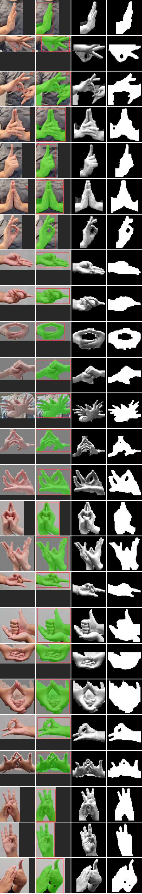
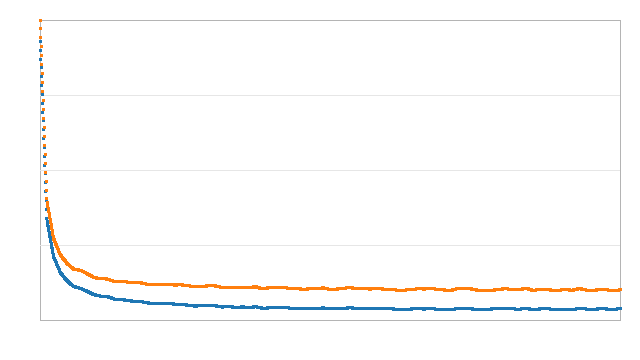

# รายงานการเทรนโมเดล (Training Report)

วันที่: 2026-11-18 14:57:14

## 1-2. Data Collection & Labeling

| คลาส (label) | ภาพดิบ | ภาพจากกล้อง |
|---|---:|---:|
| abhaya | 1 | 0 |
| chin | 1 | 0 |
| dharmachakra | 1 | 0 |
| ksepana | 1 | 0 |
| mudra_R | 1 | 0 |
| namaskara_mudra | 1 | 0 |
| vitarka_mudra | 1 | 0 |
| Bhudi | 1 | 0 |
| Bronchial | 1 | 0 |
| Dyani | 1 | 0 |
| Ganesh | 1 | 0 |
| Garuda | 1 | 0 |
| Hakini | 1 | 0 |
| Jnana | 1 | 0 |
| Kalesvera | 1 | 0 |
| Lotus | 1 | 0 |
| Pushan | 1 | 0 |
| Shivalinga | 1 | 0 |
| Ushas | 1 | 0 |
| Uttarabadhi | 1 | 0 |
| Vajra | 1 | 0 |
| Vajrapradama | 1 | 0 |
| Varuna | 1 | 0 |
| Vayu | 1 | 0 |
| shakn | 1 | 0 |

## 3-4. EDA & Data Cleaning / Preprocessing

- `abhaya.jpg` ขนาด 1280x1280 px, ROI [380, 190, 800, 820], ลบส่วนที่ไม่ใช่มือ 0 กรอบ
- `chin.jpg` ขนาด 1280x1280 px, ROI [300, 175, 1060, 540], ลบส่วนที่ไม่ใช่มือ 0 กรอบ
- `dharmachakra.jpg` ขนาด 1280x1280 px, ROI [140, 40, 1010, 900], ลบส่วนที่ไม่ใช่มือ 0 กรอบ
- `ksepana.jpg` ขนาด 1280x1280 px, ROI [330, 170, 960, 900], ลบส่วนที่ไม่ใช่มือ 0 กรอบ
- `mudra_R.jpg` ขนาด 1280x1280 px, ROI [380, 120, 830, 830], ลบส่วนที่ไม่ใช่มือ 3 กรอบ
- `namaskara_mudra.jpg` ขนาด 1280x1280 px, ROI [410, 100, 950, 770], ลบส่วนที่ไม่ใช่มือ 0 กรอบ
- `vitarka_mudra.jpg` ขนาด 1280x1280 px, ROI [400, 40, 820, 700], ลบส่วนที่ไม่ใช่มือ 5 กรอบ
- `Bhudi.jpg` ขนาด 1280x1280 px, ROI [128, 384, 1088, 922], ลบส่วนที่ไม่ใช่มือ 0 กรอบ
- `Bronchial.jpg` ขนาด 1280x1280 px, ROI [192, 486, 1088, 973], ลบส่วนที่ไม่ใช่มือ 0 กรอบ
- `Dyani.jpg` ขนาด 2208x2208 px, ROI [110, 839, 2164, 1943], ลบส่วนที่ไม่ใช่มือ 1 กรอบ
- `Ganesh.jpg` ขนาด 2208x2208 px, ROI [0, 994, 1877, 2208], ลบส่วนที่ไม่ใช่มือ 0 กรอบ
- `Garuda.jpg` ขนาด 2208x2208 px, ROI [66, 486, 2208, 2031], ลบส่วนที่ไม่ใช่มือ 0 กรอบ
- `Hakini.jpg` ขนาด 2208x2208 px, ROI [66, 596, 2208, 2142], ลบส่วนที่ไม่ใช่มือ 0 กรอบ
- `Jnana.jpg` ขนาด 2208x2208 px, ROI [221, 530, 1590, 1722], ลบส่วนที่ไม่ใช่มือ 0 กรอบ
- `Kalesvera.jpg` ขนาด 2992x2992 px, ROI [748, 359, 2244, 2543], ลบส่วนที่ไม่ใช่มือ 0 กรอบ
- `Lotus.jpg` ขนาด 2992x2992 px, ROI [449, 419, 2453, 2453], ลบส่วนที่ไม่ใช่มือ 0 กรอบ
- `Pushan.jpg` ขนาด 1280x1280 px, ROI [192, 486, 1152, 973], ลบส่วนที่ไม่ใช่มือ 0 กรอบ
- `Shivalinga.jpg` ขนาด 2992x2992 px, ROI [359, 419, 2394, 2453], ลบส่วนที่ไม่ใช่มือ 0 กรอบ
- `Ushas.jpg` ขนาด 2992x2992 px, ROI [658, 1137, 2334, 2094], ลบส่วนที่ไม่ใช่มือ 0 กรอบ
- `Uttarabadhi.jpg` ขนาด 2992x2992 px, ROI [898, 987, 2094, 2214], ลบส่วนที่ไม่ใช่มือ 0 กรอบ
- `Vajra.jpg` ขนาด 2992x2992 px, ROI [658, 1137, 2244, 2214], ลบส่วนที่ไม่ใช่มือ 0 กรอบ
- `Vajrapradama.jpg` ขนาด 2992x2992 px, ROI [449, 389, 2753, 1915], ลบส่วนที่ไม่ใช่มือ 0 กรอบ
- `Varuna.jpg` ขนาด 2992x2992 px, ROI [658, 479, 1855, 2543], ลบส่วนที่ไม่ใช่มือ 0 กรอบ
- `Vayu.jpg` ขนาด 2992x2992 px, ROI [718, 299, 1945, 2543], ลบส่วนที่ไม่ใช่มือ 0 กรอบ
- `shakn.jpg` ขนาด 1280x1280 px, ROI [320, 128, 1050, 998], ลบส่วนที่ไม่ใช่มือ 0 กรอบ

ภาพผลการแบ่งส่วนมือ (ภาพ ROI | mask สีผิว | ภาพมือที่ crop | silhouette):

## 5-6. Data Augmentation & Feature Engineering

- augment ภาพดิบภาพละ 400 ครั้ง, ภาพจากกล้องภาพละ 6 ครั้ง
- ได้ข้อมูลทั้งหมด **10013** ตัวอย่าง, เวกเตอร์ฟีเจอร์ **2035** มิติ (HOG 1764 + Silhouette 256 + Hu 7 + Shape 8)

## 7. Data Splitting (train / validation / test)

train = 7016 / val = 1499 / test = 1498

## 8. Feature Scaling & Dimensionality Reduction (PCA)

StandardScaler -> PCA: 2035 มิติ -> **120** มิติ (อธิบายความแปรปรวน 78.2%) ใช้เวลา 2.3 วินาที

## 9. Model Training

| โมเดล | Train acc | Val acc | Val macro-F1 | เวลาเทรน (วินาที) |
|---|---:|---:|---:|---:|
| kNN | 99.76% | 98.60% | 0.9860 | 0.0 |
| Softmax Regression | 99.67% | 98.27% | 0.9827 | 2.7 |
| MLP 120-128-64-25 | 100.00% | 98.67% | 0.9867 | 9.7 |

## 10. Model Selection

เลือกโมเดล **MLP 120-128-64-25** (validation macro-F1 สูงสุด = 0.9867)

Learning curve (น้ำเงิน = train loss, ส้ม = validation loss):

## 10b. Open-set Recognition (ปฏิเสธท่าที่ไม่อยู่ในฐานข้อมูล)

โมเดล softmax ต้องเลือก 1 ใน 25 ปางเสมอ จึงมีด่านตรวจ 2 ชั้น ภาพที่ไม่ผ่านจะไม่ถูกแสดงหรือบันทึกเป็นข้อความ

- **ด่าน 2 (ก่อนโมเดลจำแนก):** `d` = ระยะ kNN (k=5) ถึงกลุ่มของปางที่ใกล้ที่สุด ÷ ระยะปกติของปางนั้น (ในปริภูมิ PCA) ต้อง ≤ T โดย T = เปอร์เซ็นไทล์ที่ 90 ของภาพที่รู้จัก (validation + ภาพบิดแรง ×1.5) = 1.509 — ไม่ผ่าน = ไม่ส่งให้โมเดลจำแนกเลย
- **ด่าน 3 (หลังโมเดลจำแนก):** ความมั่นใจสูงสุดของโมเดลต้อง ≥ 0.6 — ไม่ผ่าน = ถือว่าไม่อยู่ในฐานข้อมูล
- ตั้งเกณฑ์จากภาพที่รู้จักเท่านั้น — ภาพ unknown ด้านล่างใช้ทดสอบอย่างเดียว
- เฟรมเดี่ยวที่ถูกปฏิเสธผิดจะถูก HMM กลบ ต้องถูกปฏิเสธต่อเนื่องจึงจะแสดงว่า "ไม่พบในฐานข้อมูล"
- เมื่อเพิ่มเป็น 25 ปาง วัด AUROC แล้ว `d` อย่างเดียวแยกท่าที่ไม่รู้จักได้ดีกว่า √(d·r) ที่ใช้ตอนมี 7 ปาง และการเพิ่มด่าน 3 ทำให้ปฏิเสธท่าที่ไม่รู้จักได้ ~92–95% ที่อัตรายอมรับท่าที่รู้จักใกล้เดิม

| ชุดภาพ | ชนิด | จำนวน | ยอมรับ (ส่งให้โมเดล) | ปฏิเสธ (ไม่คำนวณ) |
|---|---|---:|---:|---:|
| Validation | ท่าที่รู้จัก | 1499 | 91.7% | 8.3% |
| Test | ท่าที่รู้จัก | 1498 | 93.0% | 7.0% |
| คอ/คาง (ใบหน้าเข้ามาในกรอบ) | ไม่อยู่ในฐานข้อมูล | 60 | 1.7% | **98.3%** |
| เห็นมือไม่ครบ / ข้อมือ / แขน | ไม่อยู่ในฐานข้อมูล | 59 | 1.7% | **98.3%** |
| รูปทรงมือสุ่ม (แบมือ กางนิ้ว ฯลฯ) | ไม่อยู่ในฐานข้อมูล | 60 | 1.7% | **98.3%** |
| ครึ่งซ้าย-ขวาต่างปาง (ใกล้เคียงข้อมูลมาก) | ไม่อยู่ในฐานข้อมูล | 60 | 0.0% | **100.0%** |

## 11. Model Evaluation (Test set)

### Test set (ข้อมูลที่โมเดลไม่เคยเห็นตอนเทรน)

| คลาส | Precision | Recall | F1 | จำนวน |
|---|---:|---:|---:|---:|
| abhaya | 1.000 | 1.000 | 1.000 | 60 |
| chin | 0.984 | 1.000 | 0.992 | 60 |
| dharmachakra | 1.000 | 1.000 | 1.000 | 60 |
| ksepana | 0.984 | 1.000 | 0.992 | 60 |
| mudra_R | 1.000 | 1.000 | 1.000 | 60 |
| namaskara_mudra | 1.000 | 1.000 | 1.000 | 60 |
| vitarka_mudra | 1.000 | 0.983 | 0.992 | 60 |
| Bhudi | 0.983 | 0.950 | 0.966 | 60 |
| Bronchial | 0.983 | 0.983 | 0.983 | 60 |
| Dyani | 0.968 | 1.000 | 0.984 | 60 |
| Ganesh | 1.000 | 0.967 | 0.983 | 60 |
| Garuda | 0.982 | 0.966 | 0.974 | 58 |
| Hakini | 0.967 | 0.967 | 0.967 | 60 |
| Jnana | 0.984 | 1.000 | 0.992 | 60 |
| Kalesvera | 0.984 | 1.000 | 0.992 | 60 |
| Lotus | 0.983 | 0.983 | 0.983 | 60 |
| Pushan | 0.967 | 0.983 | 0.975 | 60 |
| Shivalinga | 1.000 | 1.000 | 1.000 | 60 |
| Ushas | 1.000 | 0.983 | 0.992 | 60 |
| Uttarabadhi | 1.000 | 0.983 | 0.992 | 60 |
| Vajra | 0.984 | 1.000 | 0.992 | 60 |
| Vajrapradama | 0.983 | 0.983 | 0.983 | 60 |
| Varuna | 1.000 | 1.000 | 1.000 | 60 |
| Vayu | 1.000 | 0.983 | 0.992 | 60 |
| shakn | 0.984 | 1.000 | 0.992 | 60 |
| **macro avg** | 0.989 | 0.989 | 0.989 | 1498 |

**Accuracy = 98.87%**

### Confusion matrix (test)

| จริง \ ทำนาย | abhaya | chin | dharmach | ksepana | mudra_R | namaskar | vitarka_ | Bhudi | Bronchia | Dyani | Ganesh | Garuda | Hakini | Jnana | Kalesver | Lotus | Pushan | Shivalin | Ushas | Uttaraba | Vajra | Vajrapra | Varuna | Vayu | shakn |
|---|---:|---:|---:|---:|---:|---:|---:|---:|---:|---:|---:|---:|---:|---:|---:|---:|---:|---:|---:|---:|---:|---:|---:|---:|---:|
| abhaya | 60 | 0 | 0 | 0 | 0 | 0 | 0 | 0 | 0 | 0 | 0 | 0 | 0 | 0 | 0 | 0 | 0 | 0 | 0 | 0 | 0 | 0 | 0 | 0 | 0 |
| chin | 0 | 60 | 0 | 0 | 0 | 0 | 0 | 0 | 0 | 0 | 0 | 0 | 0 | 0 | 0 | 0 | 0 | 0 | 0 | 0 | 0 | 0 | 0 | 0 | 0 |
| dharmachakra | 0 | 0 | 60 | 0 | 0 | 0 | 0 | 0 | 0 | 0 | 0 | 0 | 0 | 0 | 0 | 0 | 0 | 0 | 0 | 0 | 0 | 0 | 0 | 0 | 0 |
| ksepana | 0 | 0 | 0 | 60 | 0 | 0 | 0 | 0 | 0 | 0 | 0 | 0 | 0 | 0 | 0 | 0 | 0 | 0 | 0 | 0 | 0 | 0 | 0 | 0 | 0 |
| mudra_R | 0 | 0 | 0 | 0 | 60 | 0 | 0 | 0 | 0 | 0 | 0 | 0 | 0 | 0 | 0 | 0 | 0 | 0 | 0 | 0 | 0 | 0 | 0 | 0 | 0 |
| namaskara_mudra | 0 | 0 | 0 | 0 | 0 | 60 | 0 | 0 | 0 | 0 | 0 | 0 | 0 | 0 | 0 | 0 | 0 | 0 | 0 | 0 | 0 | 0 | 0 | 0 | 0 |
| vitarka_mudra | 0 | 0 | 0 | 0 | 0 | 0 | 59 | 0 | 0 | 0 | 0 | 0 | 0 | 0 | 0 | 0 | 0 | 0 | 0 | 0 | 0 | 0 | 0 | 0 | 1 |
| Bhudi | 0 | 0 | 0 | 0 | 0 | 0 | 0 | 57 | 1 | 0 | 0 | 0 | 0 | 1 | 0 | 0 | 1 | 0 | 0 | 0 | 0 | 0 | 0 | 0 | 0 |
| Bronchial | 0 | 0 | 0 | 0 | 0 | 0 | 0 | 0 | 59 | 1 | 0 | 0 | 0 | 0 | 0 | 0 | 0 | 0 | 0 | 0 | 0 | 0 | 0 | 0 | 0 |
| Dyani | 0 | 0 | 0 | 0 | 0 | 0 | 0 | 0 | 0 | 60 | 0 | 0 | 0 | 0 | 0 | 0 | 0 | 0 | 0 | 0 | 0 | 0 | 0 | 0 | 0 |
| Ganesh | 0 | 0 | 0 | 0 | 0 | 0 | 0 | 0 | 0 | 0 | 58 | 0 | 1 | 0 | 0 | 0 | 0 | 0 | 0 | 0 | 1 | 0 | 0 | 0 | 0 |
| Garuda | 0 | 0 | 0 | 0 | 0 | 0 | 0 | 0 | 0 | 1 | 0 | 56 | 0 | 0 | 0 | 0 | 1 | 0 | 0 | 0 | 0 | 0 | 0 | 0 | 0 |
| Hakini | 0 | 0 | 0 | 1 | 0 | 0 | 0 | 0 | 0 | 0 | 0 | 0 | 58 | 0 | 0 | 0 | 0 | 0 | 0 | 0 | 0 | 1 | 0 | 0 | 0 |
| Jnana | 0 | 0 | 0 | 0 | 0 | 0 | 0 | 0 | 0 | 0 | 0 | 0 | 0 | 60 | 0 | 0 | 0 | 0 | 0 | 0 | 0 | 0 | 0 | 0 | 0 |
| Kalesvera | 0 | 0 | 0 | 0 | 0 | 0 | 0 | 0 | 0 | 0 | 0 | 0 | 0 | 0 | 60 | 0 | 0 | 0 | 0 | 0 | 0 | 0 | 0 | 0 | 0 |
| Lotus | 0 | 0 | 0 | 0 | 0 | 0 | 0 | 0 | 0 | 0 | 0 | 1 | 0 | 0 | 0 | 59 | 0 | 0 | 0 | 0 | 0 | 0 | 0 | 0 | 0 |
| Pushan | 0 | 0 | 0 | 0 | 0 | 0 | 0 | 1 | 0 | 0 | 0 | 0 | 0 | 0 | 0 | 0 | 59 | 0 | 0 | 0 | 0 | 0 | 0 | 0 | 0 |
| Shivalinga | 0 | 0 | 0 | 0 | 0 | 0 | 0 | 0 | 0 | 0 | 0 | 0 | 0 | 0 | 0 | 0 | 0 | 60 | 0 | 0 | 0 | 0 | 0 | 0 | 0 |
| Ushas | 0 | 1 | 0 | 0 | 0 | 0 | 0 | 0 | 0 | 0 | 0 | 0 | 0 | 0 | 0 | 0 | 0 | 0 | 59 | 0 | 0 | 0 | 0 | 0 | 0 |
| Uttarabadhi | 0 | 0 | 0 | 0 | 0 | 0 | 0 | 0 | 0 | 0 | 0 | 0 | 1 | 0 | 0 | 0 | 0 | 0 | 0 | 59 | 0 | 0 | 0 | 0 | 0 |
| Vajra | 0 | 0 | 0 | 0 | 0 | 0 | 0 | 0 | 0 | 0 | 0 | 0 | 0 | 0 | 0 | 0 | 0 | 0 | 0 | 0 | 60 | 0 | 0 | 0 | 0 |
| Vajrapradama | 0 | 0 | 0 | 0 | 0 | 0 | 0 | 0 | 0 | 0 | 0 | 0 | 0 | 0 | 0 | 1 | 0 | 0 | 0 | 0 | 0 | 59 | 0 | 0 | 0 |
| Varuna | 0 | 0 | 0 | 0 | 0 | 0 | 0 | 0 | 0 | 0 | 0 | 0 | 0 | 0 | 0 | 0 | 0 | 0 | 0 | 0 | 0 | 0 | 60 | 0 | 0 |
| Vayu | 0 | 0 | 0 | 0 | 0 | 0 | 0 | 0 | 0 | 0 | 0 | 0 | 0 | 0 | 1 | 0 | 0 | 0 | 0 | 0 | 0 | 0 | 0 | 59 | 0 |
| shakn | 0 | 0 | 0 | 0 | 0 | 0 | 0 | 0 | 0 | 0 | 0 | 0 | 0 | 0 | 0 | 0 | 0 | 0 | 0 | 0 | 0 | 0 | 0 | 0 | 60 |

### ตรวจสอบกับภาพจริงทั้งหมดที่ไม่ผ่าน augmentation (25/25 ถูก)

| ภาพ | ป้ายจริง | ทำนาย | ความมั่นใจ |
|---|---|---|---:|
| abhaya.jpg | abhaya | abhaya | 98.9% |
| chin.jpg | chin | chin | 98.5% |
| dharmachakra.jpg | dharmachakra | dharmachakra | 99.0% |
| ksepana.jpg | ksepana | ksepana | 98.9% |
| mudra_R.jpg | mudra_R | mudra_R | 98.3% |
| namaskara_mudra.jpg | namaskara_mudra | namaskara_mudra | 98.3% |
| vitarka_mudra.jpg | vitarka_mudra | vitarka_mudra | 99.3% |
| Bhudi.jpg | Bhudi | Bhudi | 98.6% |
| Bronchial.jpg | Bronchial | Bronchial | 96.8% |
| Dyani.jpg | Dyani | Dyani | 98.4% |
| Ganesh.jpg | Ganesh | Ganesh | 98.0% |
| Garuda.jpg | Garuda | Garuda | 98.9% |
| Hakini.jpg | Hakini | Hakini | 96.6% |
| Jnana.jpg | Jnana | Jnana | 94.9% |
| Kalesvera.jpg | Kalesvera | Kalesvera | 99.3% |
| Lotus.jpg | Lotus | Lotus | 97.1% |
| Pushan.jpg | Pushan | Pushan | 96.7% |
| Shivalinga.jpg | Shivalinga | Shivalinga | 97.5% |
| Ushas.jpg | Ushas | Ushas | 98.9% |
| Uttarabadhi.jpg | Uttarabadhi | Uttarabadhi | 99.4% |
| Vajra.jpg | Vajra | Vajra | 98.5% |
| Vajrapradama.jpg | Vajrapradama | Vajrapradama | 97.5% |
| Varuna.jpg | Varuna | Varuna | 97.7% |
| Vayu.jpg | Vayu | Vayu | 98.6% |
| shakn.jpg | shakn | shakn | 98.0% |

### Robustness test (บิดภาพแรงกว่าตอนเทรน ด้วย seed ใหม่)

| ระดับการบิดภาพ | ความหมาย | Accuracy | ความมั่นใจเฉลี่ย | ผ่านด่าน open-set |
|---|---|---:|---:|---:|
| x1.0 | เท่าตอนเทรน | 98.5% | 95% | 92.5% |
| x1.5 | แรงกว่า 1.5 เท่า (หมุน ±27°) | 93.6% | 83% | 75.9% |
| x2.0 | แรงกว่า 2 เท่า (หมุน ±36°) | 77.3% | 68% | 49.1% |

> **ข้อควรระวัง:** Raw Data มีเพียงปางละ 1 ภาพ ชุด test ที่มาจากการ augment ภาพเดียวกัน จึงวัดได้แค่ความทนทานต่อการหมุน/ย่อ/แสง ไม่ใช่ความแม่นยำกับคนอื่นหรือฉากอื่น ควรเก็บข้อมูลจริงจากกล้องเพิ่ม (ปุ่ม "เก็บตัวอย่าง" ใน app.py) แล้วเทรนใหม่

## 12. Model Deployment (บันทึกโมเดล)

- ไฟล์โมเดล: `models/mudra_model.npz` (สำเนาเวอร์ชัน `models/history/mudra_model_20261118_150252.npz`)
- เวลาเทรนรวม 338.4 วินาที