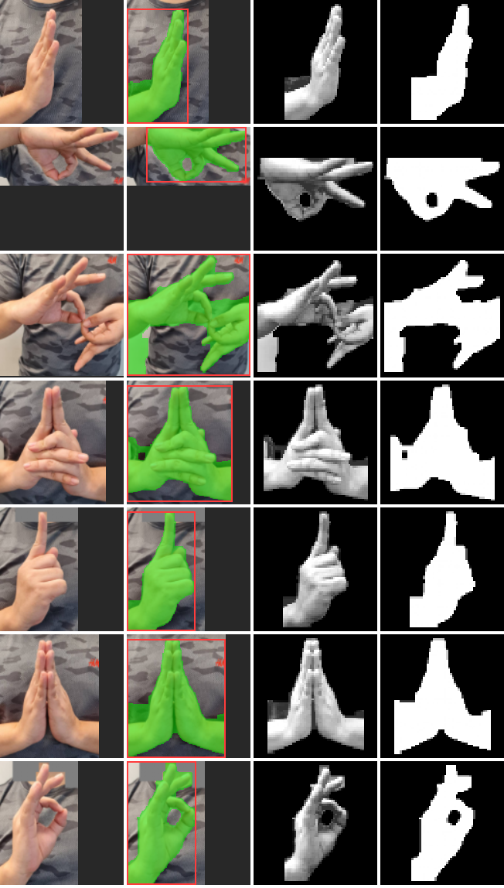
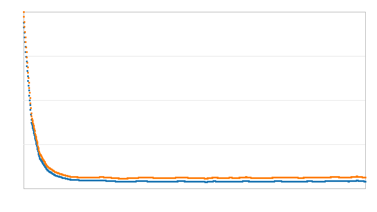

# รายงานการเทรนโมเดล (Training Report)

วันที่: 2026-11-13 16:10:35

## 1-2. Data Collection & Labeling

| คลาส (label) | ภาพดิบ | ภาพจากกล้อง |
|---|---:|---:|
| abhaya | 1 | 0 |
| chin | 1 | 0 |
| dharmachakra | 1 | 0 |
| ksepana | 1 | 0 |
| mudra_R | 1 | 0 |
| namaskara_mudra | 1 | 0 |
| vitarka_mudra | 1 | 0 |

## 3-4. EDA & Data Cleaning / Preprocessing

- `abhaya.jpg` ขนาด 1280x1280 px, ROI [380, 190, 800, 820], ลบส่วนที่ไม่ใช่มือ 0 กรอบ
- `chin.jpg` ขนาด 1280x1280 px, ROI [300, 175, 1060, 540], ลบส่วนที่ไม่ใช่มือ 0 กรอบ
- `dharmachakra.jpg` ขนาด 1280x1280 px, ROI [140, 40, 1010, 900], ลบส่วนที่ไม่ใช่มือ 0 กรอบ
- `ksepana.jpg` ขนาด 1280x1280 px, ROI [330, 170, 960, 900], ลบส่วนที่ไม่ใช่มือ 0 กรอบ
- `mudra_R.jpg` ขนาด 1280x1280 px, ROI [380, 120, 830, 830], ลบส่วนที่ไม่ใช่มือ 3 กรอบ
- `namaskara_mudra.jpg` ขนาด 1280x1280 px, ROI [410, 100, 950, 770], ลบส่วนที่ไม่ใช่มือ 0 กรอบ
- `vitarka_mudra.jpg` ขนาด 1280x1280 px, ROI [400, 40, 820, 700], ลบส่วนที่ไม่ใช่มือ 5 กรอบ

ภาพผลการแบ่งส่วนมือ (ภาพ ROI | mask สีผิว | ภาพมือที่ crop | silhouette):

## 5-6. Data Augmentation & Feature Engineering

- augment ภาพดิบภาพละ 400 ครั้ง, ภาพจากกล้องภาพละ 6 ครั้ง
- ได้ข้อมูลทั้งหมด **2807** ตัวอย่าง, เวกเตอร์ฟีเจอร์ **2035** มิติ (HOG 1764 + Silhouette 256 + Hu 7 + Shape 8)

## 7. Data Splitting (train / validation / test)

train = 1967 / val = 420 / test = 420

## 8. Feature Scaling & Dimensionality Reduction (PCA)

StandardScaler -> PCA: 2035 มิติ -> **120** มิติ (อธิบายความแปรปรวน 82.8%) ใช้เวลา 2.2 วินาที

## 9. Model Training

| โมเดล | Train acc | Val acc | Val macro-F1 | เวลาเทรน (วินาที) |
|---|---:|---:|---:|---:|
| kNN | 100.00% | 99.76% | 0.9976 | 0.0 |
| Softmax Regression | 100.00% | 99.52% | 0.9952 | 1.2 |
| MLP 120-128-64-7 | 100.00% | 99.76% | 0.9976 | 1.8 |

## 10. Model Selection

เลือกโมเดล **MLP 120-128-64-7** (validation macro-F1 สูงสุด = 0.9976)

Learning curve (น้ำเงิน = train loss, ส้ม = validation loss):

## 10b. Open-set Recognition (ปฏิเสธท่าที่ไม่อยู่ในฐานข้อมูล)

โมเดล softmax ต้องเลือก 1 ใน 7 ปางเสมอ จึงเพิ่มด่านตรวจ **ก่อน** ส่งให้โมเดลจำแนก ภาพที่ไม่ผ่านจะไม่ถูกนำไปคำนวณ

- `d` = ระยะ kNN (k=5) ถึงกลุ่มของปางที่ใกล้ที่สุด ÷ ระยะปกติของปางนั้น (ในปริภูมิ PCA)
- `r` = reconstruction error ของ PCA ÷ ค่าปกติ
- คะแนน = √(d·r) ÷ T, เกณฑ์ T = เปอร์เซ็นไทล์ที่ 90 ของภาพที่รู้จัก (validation + ภาพบิดแรง ×1.5) = 1.636
- ตั้งเกณฑ์จากภาพที่รู้จักเท่านั้น — ภาพ unknown ด้านล่างใช้ทดสอบอย่างเดียว
- เฟรมเดี่ยวที่ถูกปฏิเสธผิดจะถูก HMM กลบ ต้องถูกปฏิเสธต่อเนื่องจึงจะแสดงว่า "ไม่พบในฐานข้อมูล"

| ชุดภาพ | ชนิด | จำนวน | ยอมรับ (ส่งให้โมเดล) | ปฏิเสธ (ไม่คำนวณ) |
|---|---|---:|---:|---:|
| Validation | ท่าที่รู้จัก | 420 | 95.2% | 4.8% |
| Test | ท่าที่รู้จัก | 420 | 96.7% | 3.3% |
| คอ/คาง (ใบหน้าเข้ามาในกรอบ) | ไม่อยู่ในฐานข้อมูล | 60 | 6.7% | **93.3%** |
| เห็นมือไม่ครบ / ข้อมือ / แขน | ไม่อยู่ในฐานข้อมูล | 60 | 15.0% | **85.0%** |
| รูปทรงมือสุ่ม (แบมือ กางนิ้ว ฯลฯ) | ไม่อยู่ในฐานข้อมูล | 60 | 33.3% | **66.7%** |
| ครึ่งซ้าย-ขวาต่างปาง (ใกล้เคียงข้อมูลมาก) | ไม่อยู่ในฐานข้อมูล | 60 | 16.7% | **83.3%** |

## 11. Model Evaluation (Test set)

### Test set (ข้อมูลที่โมเดลไม่เคยเห็นตอนเทรน)

| คลาส | Precision | Recall | F1 | จำนวน |
|---|---:|---:|---:|---:|
| abhaya | 1.000 | 1.000 | 1.000 | 60 |
| chin | 1.000 | 1.000 | 1.000 | 60 |
| dharmachakra | 1.000 | 1.000 | 1.000 | 60 |
| ksepana | 1.000 | 1.000 | 1.000 | 60 |
| mudra_R | 1.000 | 1.000 | 1.000 | 60 |
| namaskara_mudra | 1.000 | 1.000 | 1.000 | 60 |
| vitarka_mudra | 1.000 | 1.000 | 1.000 | 60 |
| **macro avg** | 1.000 | 1.000 | 1.000 | 420 |

**Accuracy = 100.00%**

### Confusion matrix (test)

| จริง \ ทำนาย | abhaya | chin | dharmach | ksepana | mudra_R | namaskar | vitarka_ |
|---|---:|---:|---:|---:|---:|---:|---:|
| abhaya | 60 | 0 | 0 | 0 | 0 | 0 | 0 |
| chin | 0 | 60 | 0 | 0 | 0 | 0 | 0 |
| dharmachakra | 0 | 0 | 60 | 0 | 0 | 0 | 0 |
| ksepana | 0 | 0 | 0 | 60 | 0 | 0 | 0 |
| mudra_R | 0 | 0 | 0 | 0 | 60 | 0 | 0 |
| namaskara_mudra | 0 | 0 | 0 | 0 | 0 | 60 | 0 |
| vitarka_mudra | 0 | 0 | 0 | 0 | 0 | 0 | 60 |

### ตรวจสอบกับภาพจริงทั้งหมดที่ไม่ผ่าน augmentation (7/7 ถูก)

| ภาพ | ป้ายจริง | ทำนาย | ความมั่นใจ |
|---|---|---|---:|
| abhaya.jpg | abhaya | abhaya | 98.1% |
| chin.jpg | chin | chin | 97.7% |
| dharmachakra.jpg | dharmachakra | dharmachakra | 98.5% |
| ksepana.jpg | ksepana | ksepana | 98.4% |
| mudra_R.jpg | mudra_R | mudra_R | 98.9% |
| namaskara_mudra.jpg | namaskara_mudra | namaskara_mudra | 97.9% |
| vitarka_mudra.jpg | vitarka_mudra | vitarka_mudra | 98.6% |

### Robustness test (บิดภาพแรงกว่าตอนเทรน ด้วย seed ใหม่)

| ระดับการบิดภาพ | ความหมาย | Accuracy | ความมั่นใจเฉลี่ย | ผ่านด่าน open-set |
|---|---|---:|---:|---:|
| x1.0 | เท่าตอนเทรน | 99.0% | 96% | 97.6% |
| x1.5 | แรงกว่า 1.5 เท่า (หมุน ±27°) | 97.6% | 89% | 85.2% |
| x2.0 | แรงกว่า 2 เท่า (หมุน ±36°) | 84.3% | 75% | 61.9% |

> **ข้อควรระวัง:** Raw Data มีเพียงปางละ 1 ภาพ ชุด test ที่มาจากการ augment ภาพเดียวกัน จึงวัดได้แค่ความทนทานต่อการหมุน/ย่อ/แสง ไม่ใช่ความแม่นยำกับคนอื่นหรือฉากอื่น ควรเก็บข้อมูลจริงจากกล้องเพิ่ม (ปุ่ม "เก็บตัวอย่าง" ใน app.py) แล้วเทรนใหม่

## 12. Model Deployment (บันทึกโมเดล)

- ไฟล์โมเดล: `models/mudra_model.npz` (สำเนาเวอร์ชัน `models/history/mudra_model_20261113_161225.npz`)
- เวลาเทรนรวม 110.0 วินาที